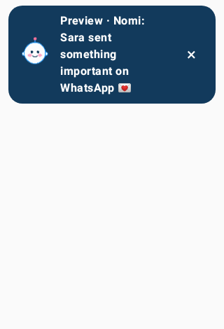

# Nomi

## Latest development build · 0.2.0

[Download Nomi 0.2.0 APK (29 MB)](https://github.com/Mhret-e/nomi/raw/refs/heads/main/downloads/Nomi-0.2.0-debug.apk) · [Checksum](downloads/Nomi-0.2.0-debug.apk.sha256) · [Update notes](downloads/Nomi-0.2.0-notes.md)

Includes the smiling mascot image and animated important-notification banner. After installing, open **Settings → Preview Nomi animation** to try the greeting without granting special permissions.

This is a debug-signed development build for Android 9 or later. Supabase is not configured. The banner was rendered and tested in simulated Android; hardware/OEM notification and overlay behavior still need device testing.

[Original 0.1.0 APK](https://github.com/Mhret-e/nomi/raw/refs/heads/main/downloads/Nomi-debug.apk)
