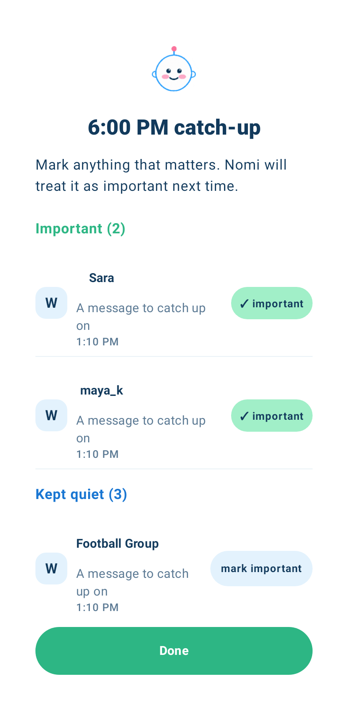
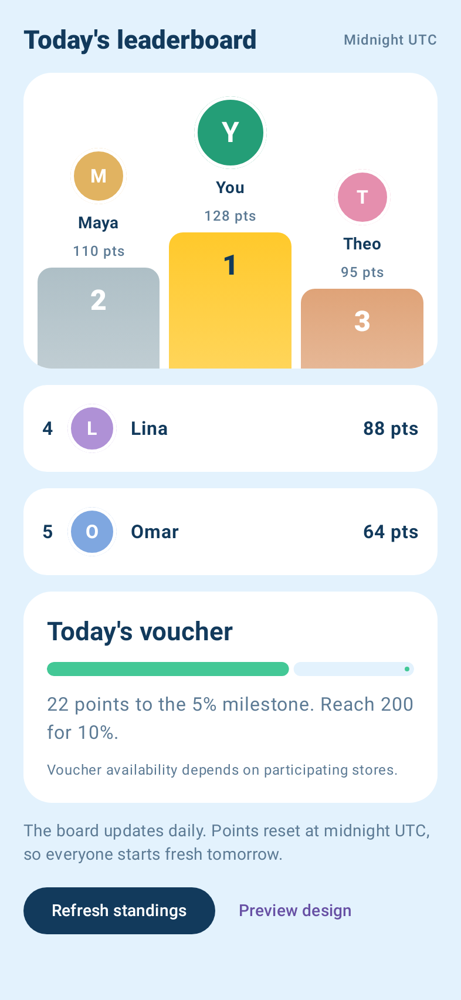

# Nomi

## Latest development build · 0.4.0

[Download Nomi 0.4.0 APK](https://github.com/Mhret-e/nomi/raw/refs/heads/main/downloads/Nomi-0.4.0-debug.apk) · [Checksum](downloads/Nomi-0.4.0-debug.apk.sha256) · [Update notes](downloads/Nomi-0.4.0-notes.md) · [Backend setup ZIP](downloads/Nomi-0.4.0-backend-setup.zip)

Public Supabase configuration is embedded. Includes the animated smiling mascot and redesigned catch-up, leaderboard, stores and recap, plus local erasure and an authenticated account-deletion client. Android 9+, targeting API 36. Same development signing certificate as earlier APKs.

41 Android tests, 19 Edge/web-client tests and local SQL/RLS checks passed; lint has zero errors and 22 warnings. This is a debug development build. Live Supabase access is blocked in the current workspace; migrations and Edge Functions still require deployment. No confirmed voucher partners or verified venue photos yet. The external deletion page still needs hosting and a support contact.

## Previous development build · 0.3.0

[Download Nomi 0.3.0 APK (29 MB)](https://github.com/Mhret-e/nomi/raw/refs/heads/main/downloads/Nomi-0.3.0-debug.apk) · [Checksum](downloads/Nomi-0.3.0-debug.apk.sha256) · [Update notes](downloads/Nomi-0.3.0-notes.md)

**Catch-up:** tap the tab for the animated dialog. Real captured notifications appear after choosing apps and granting notification access; no example notifications are silently inserted.

**Board:** new podium and ranked cards. Preview design shows labeled examples; normal mode uses real local progress or connected standings.

**Stores:** six Sharjah/Dubai businesses from the user's references, with no claimed Nomi agreements. Verified photos are still pending website access and source/rights checks.

**Recap:** rounded cards and a mint chart, using actual local history.

Build, 37 unit/rendered-UI tests, lint and local SQL/RLS checks passed. Live Supabase remains unconfigured. This is a debug-signed development build for Android 9 or later. Device-specific delivery and overlay checks remain necessary.

### Rendered design examples (simulated Android, test data)

### Earlier builds

[0.2.0 mascot update](https://github.com/Mhret-e/nomi/raw/refs/heads/main/downloads/Nomi-0.2.0-debug.apk) · [Original 0.1.0](https://github.com/Mhret-e/nomi/raw/refs/heads/main/downloads/Nomi-debug.apk)
